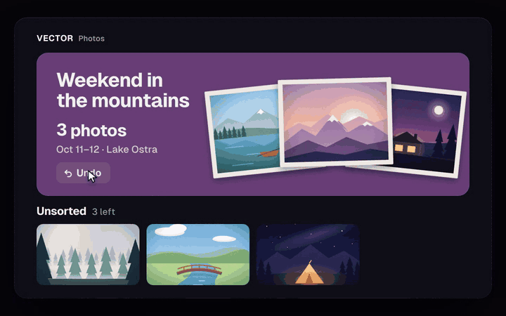

# Photo Album

**Drop a trip photo on the album. It lands on the cover as a print, and the cover takes its colour.**



**Live demo:** [veraetogrex-portfolio.github.io/photo-album](https://veraetogrex-portfolio.github.io/photo-album/) · **Mockup:** [full-screen version](https://veraetogrex-portfolio.github.io/photo-album/mockup/photo-album.html)

A photos screen with one album, "Weekend in the mountains", and a tray of unsorted trip photos under it. The album's cover is a small pile of its own prints on a board tinted by the print in front. Pick up a photo and the tray closes the gap; bring it over the album and the pile spreads to make room. Let go and it lands in front on warm photo paper, the board turns to its colour, "2 photos" rolls to "3 photos" and the tray reads "3 left". Undo flies it back to its place in the tray.

## Use it

Three files, no build step, no dependencies, no web fonts:

```
index.html   markup: the album card, the tray heading
style.css    styles
script.js    the photos, drag, pile and undo
```

Download the repo and open `index.html`, or copy the three files into your project.

## Try it

- Drag any photo from the tray onto the album. It can land anywhere on the album card; the pile opens up while you hover.
- Drop it outside the album, or press Esc while dragging, and it goes back to its place in the tray.
- Click a photo, or focus it and press Enter or Space: it travels to the album by itself and focus moves on to the next photo. ← → move between the photos in the tray.
- Click Undo, or press Ctrl+Z / ⌘Z, to take the last photo back out. Only the last one can be undone.
- Sort all four and the tray says "All sorted"; the cover shows the three newest prints.
- With reduced motion turned on, the photos move at once.

## Make it yours

At the top of `script.js`:

- `PHOTOS`: the pictures, each a title and an inline 400×300 SVG. Swap the SVG for an `<image href="…">` to use real photos.
- `TINT`: the cover colour for each photo when it's in front. Keep it dark enough for white text.
- `LOOSE` and `INSIDE`: which photos start in the tray and which are already in the album (the last one in `INSIDE` is in front).
- `TRAY`, `CARD`, `COVER`: where the tray row, the drop area and the pile sit. `TILE` and `PRINT` are the picture scale as a tile and as a print; `PILE` and `PAIR` set the offset and tilt of each print in the pile.

The album name and dates are plain text in `index.html`. Colours live in `:root` in `style.css`: `--paper` for the print border, `--glacier` for focus, `--on-cover` for the dates on the tinted board.

## What's in `mockup/`

The full 1440×900 screen this component was shot in for the reel:

- `mockup/photo-album.html` — interactive. `D` plays the demo, `R` resets.
- `mockup/photo-album.autoplay.html` — the scripted loop the reel was recorded from.
- URL flags: `?frame` puts the screen in a browser window, `?clean` hides the control panel, `?once` plays the demo once.

The mockup loads the same `style.css` and `script.js` from the root, plus a shared stage runtime and bundled fonts from `mockup/_shared/`. The component in the root doesn't need any of it.

---

Component 32 of a series. New one every day on Instagram [@veraetogrex_portfolio](https://www.instagram.com/veraetogrex_portfolio/) · all components: [github.com/veraetogrex-portfolio](https://github.com/veraetogrex-portfolio)

MIT licensed.
